# マルコメ / Marukome

**開発ツールとインフラ自動化が好きな OSS コントリビューター 🛠️** 
📍 Aichi, Japan · 🏢 [@OpenUp-LabTakizawa](https://github.com/OpenUp-LabTakizawa) · 🧪 [@aletheia-works](https://github.com/aletheia-works)

## 👋 About me

- 🏢 [OpenUp-LabTakizawa](https://github.com/OpenUp-LabTakizawa) で Web アプリ・サイネージ・インフラを作っています
- 🧪 [aletheia-works](https://github.com/aletheia-works) で、ブラウザだけでバグを再現できる **Vivarium / Terrarium** を開発中
- 🔧 [mise](https://github.com/jdx/mise) や [aqua](https://github.com/aquaproj/aqua-registry) など、開発ツールへのコントリビュートがライフワーク
- 😎 一緒に遊ぼう！

## 🔭 OSS contributions

<!--START_SECTION:oss-->
| | Repository | ⭐ Stars | Merged PRs |
| :-: | :-- | --: | --: |
|  | [aletheia-works/paludarium](https://github.com/aletheia-works/paludarium) | 2 | [881](https://github.com/aletheia-works/paludarium/pulls?q=is%3Apr+author%3AMarukome0743+is%3Amerged) |
|  | [aletheia-works/formicarium](https://github.com/aletheia-works/formicarium) | 1 | [54](https://github.com/aletheia-works/formicarium/pulls?q=is%3Apr+author%3AMarukome0743+is%3Amerged) |
|  | [aletheia-works/vivarium](https://github.com/aletheia-works/vivarium) | 0 | [47](https://github.com/aletheia-works/vivarium/pulls?q=is%3Apr+author%3AMarukome0743+is%3Amerged) |
|  | [aletheia-works/.github](https://github.com/aletheia-works/.github) | 0 | [8](https://github.com/aletheia-works/.github/pulls?q=is%3Apr+author%3AMarukome0743+is%3Amerged) |
|  | [Dolibarr/dolibarr](https://github.com/Dolibarr/dolibarr) | 7.9k | [5](https://github.com/Dolibarr/dolibarr/pulls?q=is%3Apr+author%3AMarukome0743+is%3Amerged) |
|  | [aletheia-works/coi-serviceworker](https://github.com/aletheia-works/coi-serviceworker) | 0 | [3](https://github.com/aletheia-works/coi-serviceworker/pulls?q=is%3Apr+author%3AMarukome0743+is%3Amerged) |
|  | [duplicati/duplicati](https://github.com/duplicati/duplicati) | 15.2k | [2](https://github.com/duplicati/duplicati/pulls?q=is%3Apr+author%3AMarukome0743+is%3Amerged) |

<b>🆕 Latest merged pull requests</b>

- `2026-11-28` **aletheia-works/paludarium** — [test(perf): retry the group throttle check on Linux and check the leader&#x27;s THROTTLE record](https://github.com/aletheia-works/paludarium/pull/1200)
- `2026-11-26` **aletheia-works/formicarium** — [fix(showcase): resolve zlib from its GitHub release](https://github.com/aletheia-works/formicarium/pull/321)
- `2026-11-21` **aletheia-works/vivarium** — [feat(layer3): move the motionEye #3524 preview to 663a5be](https://github.com/aletheia-works/vivarium/pull/747)
- `2026-11-19` **duplicati/duplicati** — [Find created APFS snapshot by date instead of last listed snapshot](https://github.com/duplicati/duplicati/pull/7920)
- `2026-11-11` **aletheia-works/coi-serviceworker** — [chore(actions): pin aletheia-works/.github v1.4.1, so the bot&#x27;s autofix push gets reviewed](https://github.com/aletheia-works/coi-serviceworker/pull/27)
- `2026-11-11` **aletheia-works/.github** — [fix(workflows): let aletheia-works-bot&#x27;s autofix push start the Claude review](https://github.com/aletheia-works/.github/pull/88)
- `2026-11-06` **Dolibarr/dolibarr** — [FIX REST API: POST /shipments/{id}/lines stores a kit without its components](https://github.com/Dolibarr/dolibarr/pull/42732)

1,000 merged PRs across 7 external repositories · updated 2026-11-28 by GitHub Actions
<!--END_SECTION:oss-->

## 🛠️ Tech stack

| | |
| :-- | :-- |
| **Main** |  |
| **Infra** |  |
| **Also** |  |
| **Tools** |     |

## 📊 Stats

  <picture>
    <source media="(prefers-color-scheme: dark)" srcset="./profile/stats-dark.svg">
    
  </picture>
  <picture>
    <source media="(prefers-color-scheme: dark)" srcset="./profile/top-langs-dark.svg">
    
  </picture>
   
  <picture>
    <source media="(prefers-color-scheme: dark)" srcset="./profile/snake-dark.svg">
    
  </picture>

