# マルコメ / Marukome

**開発ツールとインフラ自動化が好きな OSS コントリビューター 🛠️** 
📍 Aichi, Japan · 🏢 [@OpenUp-LabTakizawa](https://github.com/OpenUp-LabTakizawa) · 🧪 [@aletheia-works](https://github.com/aletheia-works)

## 👋 About me

- 🏢 [OpenUp-LabTakizawa](https://github.com/OpenUp-LabTakizawa) で Web アプリ・サイネージ・インフラを作っています
- 🧪 [aletheia-works](https://github.com/aletheia-works) で、ブラウザだけでバグを再現できる **Vivarium / Terrarium** を開発中
- 🔧 [mise](https://github.com/jdx/mise) や [aqua](https://github.com/aquaproj/aqua-registry) など、開発ツールへのコントリビュートがライフワーク
- 😎 一緒に遊ぼう！

## 🔭 OSS contributions

<!--START_SECTION:oss-->
| | Repository | ⭐ Stars | Merged PRs |
| :-: | :-- | --: | --: |
|  | [aletheia-works/paludarium](https://github.com/aletheia-works/paludarium) | 1 | [352](https://github.com/aletheia-works/paludarium/pulls?q=is%3Apr+author%3AMarukome0743+is%3Amerged) |
|  | [aletheia-works/formicarium](https://github.com/aletheia-works/formicarium) | 1 | [205](https://github.com/aletheia-works/formicarium/pulls?q=is%3Apr+author%3AMarukome0743+is%3Amerged) |
|  | [jdx/mise](https://github.com/jdx/mise) | 36.0k | [132](https://github.com/jdx/mise/pulls?q=is%3Apr+author%3AMarukome0743+is%3Amerged) |
|  | [aletheia-works/vivarium](https://github.com/aletheia-works/vivarium) | 0 | [103](https://github.com/aletheia-works/vivarium/pulls?q=is%3Apr+author%3AMarukome0743+is%3Amerged) |
|  | [aquaproj/aqua-registry](https://github.com/aquaproj/aqua-registry) | 398 | [68](https://github.com/aquaproj/aqua-registry/pulls?q=is%3Apr+author%3AMarukome0743+is%3Amerged) |
|  | [jdx/pitchfork](https://github.com/jdx/pitchfork) | 713 | [23](https://github.com/jdx/pitchfork/pulls?q=is%3Apr+author%3AMarukome0743+is%3Amerged) |
|  | [aletheia-works/.github](https://github.com/aletheia-works/.github) | 0 | [14](https://github.com/aletheia-works/.github/pulls?q=is%3Apr+author%3AMarukome0743+is%3Amerged) |
|  | [Dokploy/dokploy](https://github.com/Dokploy/dokploy) | 38.3k | [14](https://github.com/Dokploy/dokploy/pulls?q=is%3Apr+author%3AMarukome0743+is%3Amerged) |

<b>🆕 Latest merged pull requests</b>

- `2026-11-09` **aletheia-works/paludarium** — [feat(kernel): give ETXTBSY between a running program&#x27;s file and writes to it](https://github.com/aletheia-works/paludarium/pull/406)
- `2026-11-08` **duplicati/duplicati** — [Fix memory growth when backing up macOS Photos](https://github.com/duplicati/duplicati/pull/7736)
- `2026-11-07` **aletheia-works/.github** — [docs(profile): describe every current project and invite new members](https://github.com/aletheia-works/.github/pull/85)
- `2026-11-07` **aletheia-works/vivarium** — [docs(layer2): describe each recipe&#x27;s verdict as Contract v1 does now](https://github.com/aletheia-works/vivarium/pull/722)
- `2026-11-07` **aletheia-works/coi-serviceworker** — [chore: name the maintainers team as the code owner](https://github.com/aletheia-works/coi-serviceworker/pull/22)
- `2026-11-07` **aletheia-works/formicarium** — [chore: name the maintainers team as the code owner](https://github.com/aletheia-works/formicarium/pull/274)
- `2026-11-06` **Dolibarr/dolibarr** — [FIX REST API: POST /shipments/{id}/lines stores a kit without its components](https://github.com/Dolibarr/dolibarr/pull/42732)
- `2026-10-31` **jj-vcs/jj** — [web/docs: update astro to 7.4.4 and depend on @astrojs/markdown-remark](https://github.com/jj-vcs/jj/pull/10516)

1,000 merged PRs across 46 external repositories · updated 2026-11-09 by GitHub Actions
<!--END_SECTION:oss-->

## 🛠️ Tech stack

| | |
| :-- | :-- |
| **Main** |  |
| **Infra** |  |
| **Also** |  |
| **Tools** |     |

## 📊 Stats

  <picture>
    <source media="(prefers-color-scheme: dark)" srcset="./profile/stats-dark.svg">
    
  </picture>
  <picture>
    <source media="(prefers-color-scheme: dark)" srcset="./profile/top-langs-dark.svg">
    
  </picture>
   
  <picture>
    <source media="(prefers-color-scheme: dark)" srcset="./profile/snake-dark.svg">
    
  </picture>

